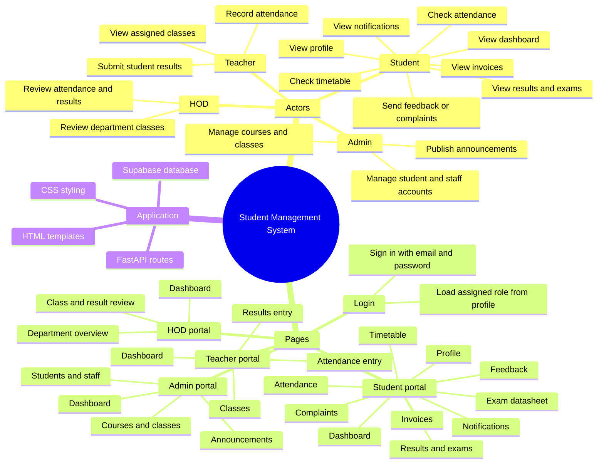

# Student Management System — Project Mind Map



## Build scope

The project includes the **Login** page and role-specific portal pages. Authentication and portal reads/writes use Supabase after the schema and role policies are applied and accounts have matching `profiles` rows.

## Simple page flow

```text
Login → Student dashboard → Select a section from the sidebar
```

## Interactive project map

Open `/map` to explore this structure. Radial is the default for up to 60 nodes; use the Layout buttons to switch between Radial and Tree. Search, filters, node expansion, and layout preference work in the current browser session. `/map?test=1` runs the radial label-collision checks for the 2-page, 30-page, and 40-page sample sites.

The map loads D3 v7 from jsDelivr, so its interactive layout requires an internet connection. Supabase setup steps are documented in [SUPABASE_SETUP.md](./SUPABASE_SETUP.md).
